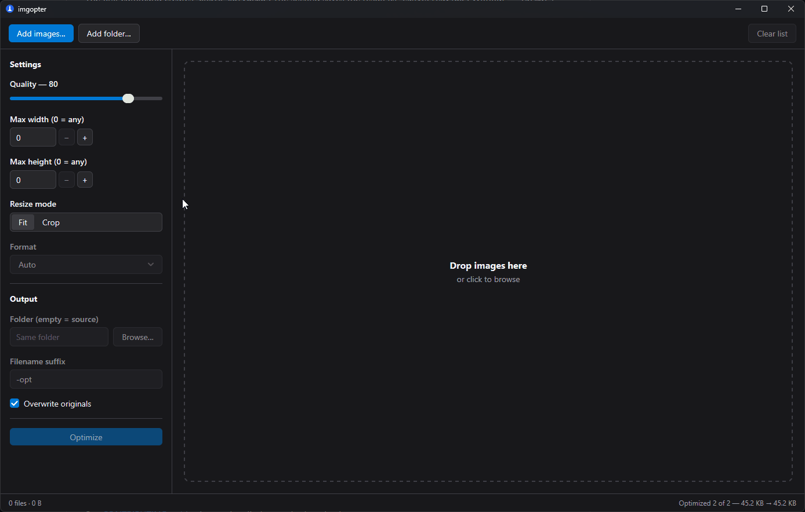

# imgopter

Resize, compress, and convert images from a desktop app or the command line. Process individual files or whole folders and see how much space you save.

imgopter reads JPEG, PNG, WebP, GIF, BMP, and TIFF. It saves JPEG, PNG, and WebP, keeping your originals by default.



## Install

### Desktop app

Download the installer for your platform from the [latest release](https://github.com/auron-labs/imgopter/releases/latest):

| Platform | Download | Install |
| --- | --- | --- |
| macOS (Intel or Apple silicon) | `.dmg` | Open it and drag imgopter to Applications |
| Windows (x64) | `imgopter Setup … .exe` | Run the installer |
| Linux (x64) | `.deb` or `imgopter-…-linux-amd64.tar.gz` | Install the Debian package, or extract the archive and run `./imgopter` |

Open imgopter, click **Add images…** or **Add folder…**, adjust the settings, and click **Optimize**. Results are saved beside the originals with `-opt` added to the filename, unless you choose an output folder.

On Linux, the desktop app needs GTK 3 and WebKitGTK installed.

### Command line

On macOS and Linux, install with [bin](https://github.com/aaronflorey/bin):

```sh
bin install github.com/auron-labs/imgopter
```

For a manual install, download `imgopter_<version>_<os>_<arch>.tar.gz` (or `.zip` on Windows) from the [latest release](https://github.com/auron-labs/imgopter/releases/latest). Choose `darwin` for macOS, `linux` for Linux, or `windows` for Windows, and `arm64` or `amd64` for your processor. Extract it and put `imgopter` (`imgopter.exe` on Windows) in a directory on your `PATH`.

CLI archives use underscores in their names; desktop packages use spaces or hyphens. If bin asks you to choose an asset, select the CLI archive.

Try it:

```sh
imgopter photo.jpg
```

This creates `photo-opt.jpg` and prints the original size, new size, and percentage saved.

## Common tasks

Put options before paths. Pass files, folders, or quoted globs such as `'photos/*.jpg'`.

### Resize a photo

Fit a photo within 1600 × 1200 pixels while keeping its proportions:

```sh
imgopter --max-width 1600 --max-height 1200 photo.jpg
```

Smaller images keep their size. Set just one dimension to limit only the width or height.

For a square thumbnail, use crop mode:

```sh
imgopter --mode crop --max-width 400 --max-height 400 photo.jpg
```

This crops from the center to exactly 400 × 400 pixels and can enlarge small images.

### Optimize a folder

Process a folder and its subfolders, saving the results into `optimized/`:

```sh
imgopter --recursive --out optimized photos/
```

Outputs go directly into `optimized/`, without subfolders. Duplicate output names stop the batch before writing; process those folders separately.

### Convert to WebP or JPEG

```sh
imgopter --format webp photo.jpg
imgopter --format jpeg --out converted.jpg photo.png
```

These create `photo-opt.webp` and `converted.jpg`. Without `--format`, JPEG, PNG, and WebP keep their format; GIF, BMP, and TIFF become PNG.

### Adjust quality

Quality defaults to 80. Lower it for smaller files, or raise it to retain more detail:

```sh
imgopter --quality 65 photo.jpg
```

For PNG, quality below 100 reduces the color palette. Use `--quality 100` to preserve pixel colors:

```sh
imgopter --quality 100 screenshot.png
```

Run `imgopter --help` for all options, including output naming and parallel workers.

## What happens to your images

Originals stay in place unless you choose **Overwrite originals** in the app or pass `--overwrite` to the CLI. Back them up before using that option. To convert GIF, BMP, or TIFF, save a separate output instead of overwriting the input.

Re-encoding removes metadata, including EXIF, color profiles, and comments. Animated images become a single frame. These changes also apply at quality 100.

Some images get larger after re-encoding. imgopter shows the size change and saves the result either way. Existing output files can be replaced, so choose a fresh output folder if you want to keep earlier results.

## Development

To build from source, use Go 1.27.1 or newer:

```sh
go build -o build/imgopter ./cmd/imgopter
go run ./gui
```

For development, [mise](https://mise.jdx.dev/) installs the pinned tools:

```sh
mise install
mise run test
mise run build:cli
mise run dev
```

Use `mise run build:gui` to package the desktop app for your current platform. Build outputs go into `build/`.

See [CONTRIBUTING.md](CONTRIBUTING.md) for formatting, linting, and other checks.

## License

[MIT](LICENSE).
